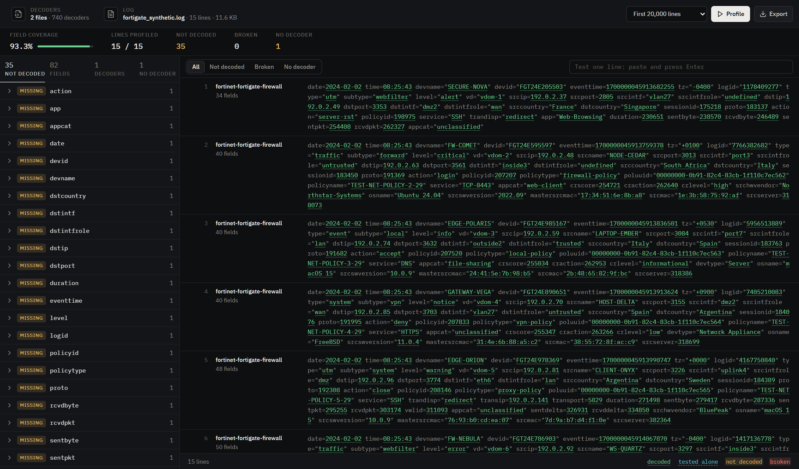
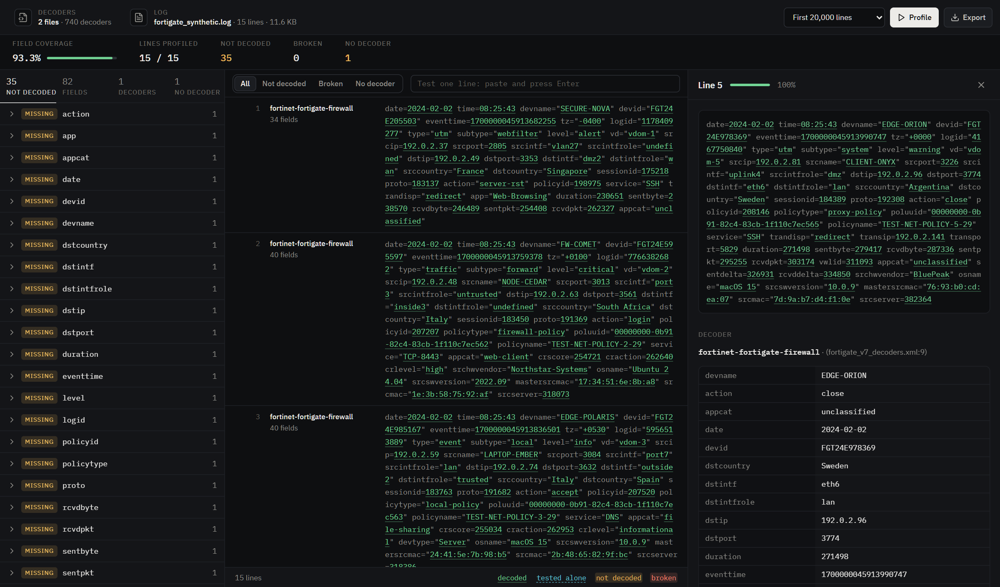
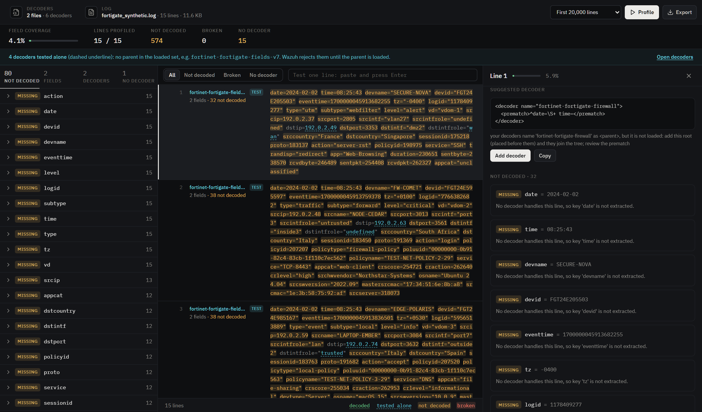
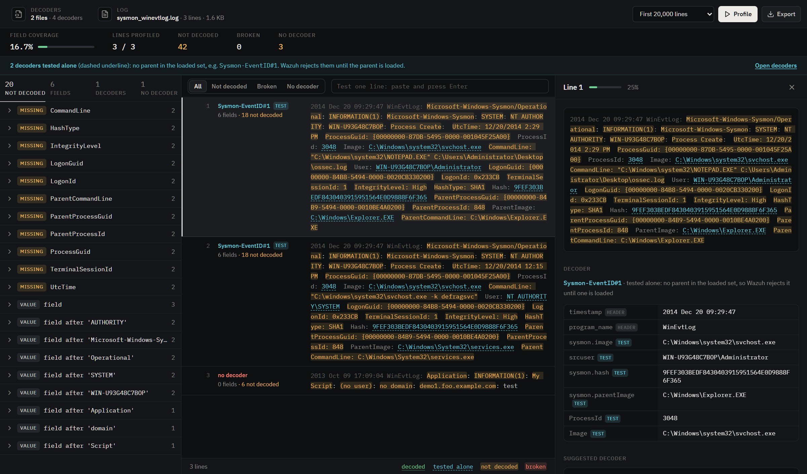
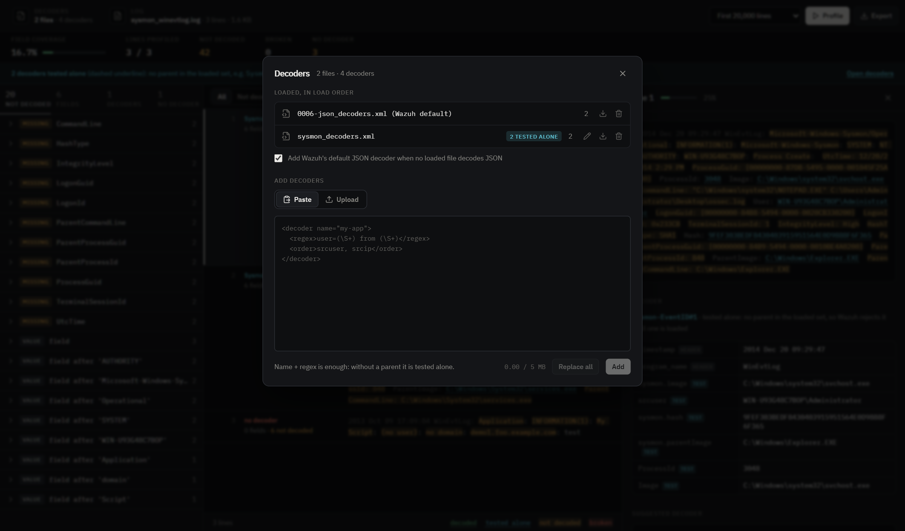

# Decoder-Viewer

A local workbench for Wazuh decoders. Load decoder XML and raw logs, and see,
character by character, what Wazuh extracts and what it leaves behind. Write a
decoder, paste it, and the log updates at once; no Wazuh manager needed.



## Features

- **Decodes like Wazuh.** The engine is a port of `wazuh-analysisd` 4.11.2
  decoding (pre-decoder, root/child selection, sibling chains, OS_Regex,
  OS_Match, PCRE2, JSON_Decoder), not a regex imitation.
- **Shows what is not decoded.** Keys no decoder reads, decoders that target a
  key but fail on a line, JSON keys, and IPs, numbers or paths left in free text.
- **Tests one decoder at a time.** A decoder with only a name and a regex, or a
  child whose parent is not loaded yet, is run alone and its matches are shown.
- **Explains every line.** A step-by-step trace of the decoders Wazuh tries, in
  order, with the reason when nothing matches.
- **Suggests decoders.** For each missing value, and for whole log formats with
  no decoder, each suggestion is checked against the log before it is offered.
- **Any log type.** Firewall, EDR, Windows, Linux, JSON, CEF/LEEF, key=value,
  free text, Wazuh `archives.log` / `archives.json`.

| Decoded line | Line with no decoder |
|---|---|
|  |  |

| Decoder tested alone | Loading decoders |
|---|---|
|  |  |

## Quick start

Requirements: Python 3.10+ and Node.js 18+ on PATH.

| OS | Run |
|---|---|
| Windows | `start.bat` |
| Linux / macOS | `./start.sh` |

The first run creates `.venv` and installs the frontend packages. The app opens
at <http://127.0.0.1:5173> with a small demo loaded. Stop it with any key in the
`start.bat` window, or Ctrl+C for `start.sh`.

Then:

1. **Decoders**: paste a decoder and press **Add** (pastes add up), or upload
   your `.xml` files.
2. **Log**: paste lines or upload a log file.
3. Click a line to see its fields, what is not decoded, and the trace.

The [samples](samples/) folder has ready-made sets to try: the demo, a FortiGate
decoder set with synthetic logs, and a Windows Sysmon decoder tested alone.

## Documentation

- [Usage](docs/usage.md): every screen and action.
- [How it works](docs/how-it-works.md): the decoding engine, how gaps are found,
  how decoders are generated, accuracy and limits.

## Limits

| | Paste | Upload |
|---|---|---|
| Logs | up to 5 MB | streamed to disk, practical up to ~1 GB |
| Decoders | XML, added one paste at a time | one or many `.xml` files |

gzip files are not read. Only Wazuh decoder XML is understood; logs from any
product work.

## Project layout

```
backend/    FastAPI service and the decoding engine (backend/app), tests (backend/tests)
frontend/   React + Vite user interface
samples/    decoder + log sets to try
docs/       usage, internals, screenshots
start.bat   Windows launcher
start.sh    Linux / macOS launcher
```

## Development

```bash
cd backend && ../.venv/Scripts/python -m pytest -q    # Linux/macOS: ../.venv/bin/python
cd frontend && npm run build
```

The backend listens on 127.0.0.1:8000 and the UI on 127.0.0.1:5173; only the
UI's origin may call the API from a browser.

## License

GNU General Public License v2.0, see [LICENSE](LICENSE).

The decoding engine is a Python port of logic from
[Wazuh](https://github.com/wazuh/wazuh) 4.11.2 (GPLv2), and Wazuh's stock
`0006-json_decoders.xml` is embedded. The FortiGate sample decoders are by
Alexander Tibor Assenheimer (GPLv2).
